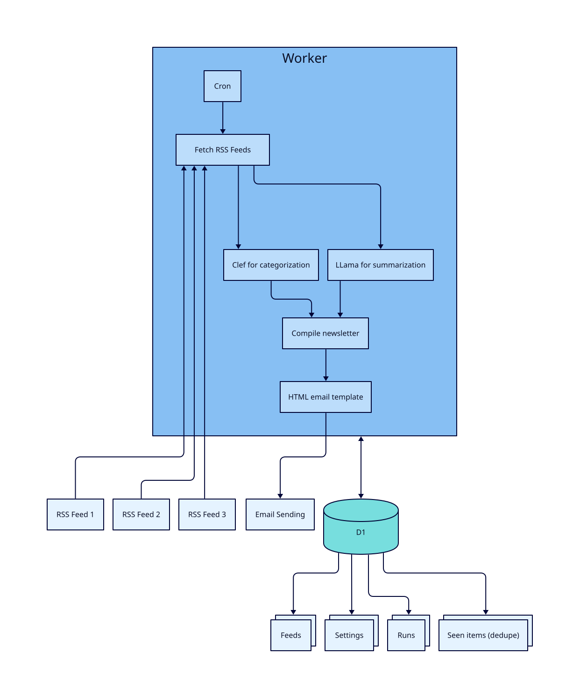

# newsroom

Daily RSS digest on a Cloudflare Worker with D1, behind Cloudflare Access. It collects RSS feeds, classifies with Workers AI's `clef-flash`, summarizes with Llama and emails at a cadence set up by the user.



## Dev

```
npm install
npm run dev
npx wrangler d1 migrations apply newsroom --local
```
