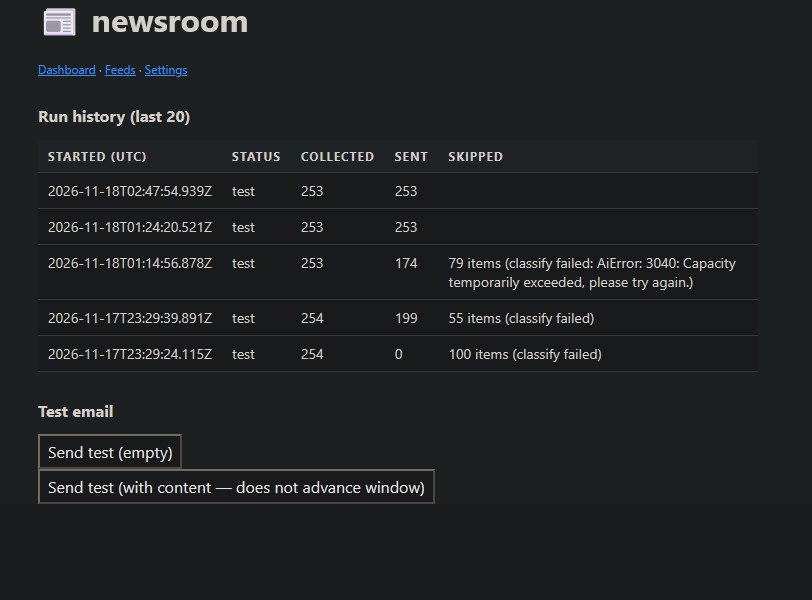
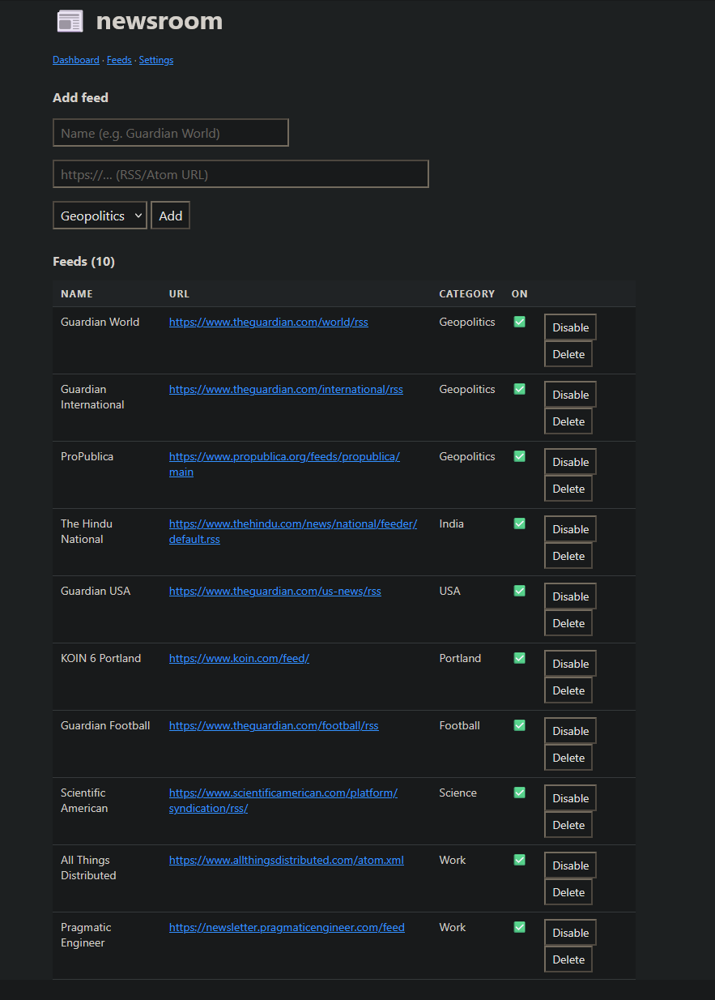
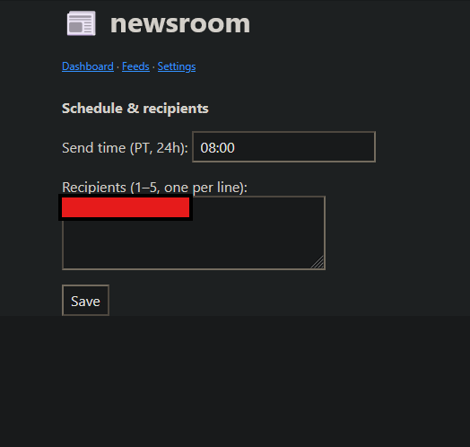

# newsroom

Daily RSS digest on a Cloudflare Worker with D1, behind Cloudflare Access. It collects RSS feeds, classifies with Workers AI's `clef-flash`, summarizes with Llama and emails at a cadence set up by the user.


## Dev

CI (`.github/workflows/deploy.yml`) does everything on push to main: 
- build
- `terraform apply`
- D1 migrations
- commit back `terraform.tfstate`

For local dev:

```sh
npm install
npm run dev
npx wrangler d1 migrations apply newsroom --local
```

To copy and apply this, you'll need the Worker code itself in 'src/', and the infrastructure provisioned through `terraform/main.tf`. You will need the following secrets set on your Github Secrets:

- `CLOUDFLARE_ACCOUNT_ID`: 32-character hexadecimal Cloudflare account tag. Doesn't need to be a secret tbh
- `CLOUDFLARE_ACCOUNT_TOKEN`: Account token on your Cloudflare account with the following policies:
    - Zone scoped:
        - DNS Edit
        - Zone Edit
        - Email Routing Rules Edit
    - Account scoped:
        - D1 Edit
        - Workers Admin (can be scoped to specific Worker after you create it)
        - Access: Apps Edit & Revoke
        - Access: Organizations, IdPs and Groups Edit & Revoke
        - Access: Policies Edit
        - Email Sending Edit


## Demo and Setup



The newsroom panel gives you options to send empty test emails or with content (grabs RSS feeds, dedupes and sends you today's digest but doesn't progress the timestamp marker). You can also set up your Feeds there, with different categories for Clef to put it into:



Set up recipients and a time schedule to hook into the Worker cron in Settings:

